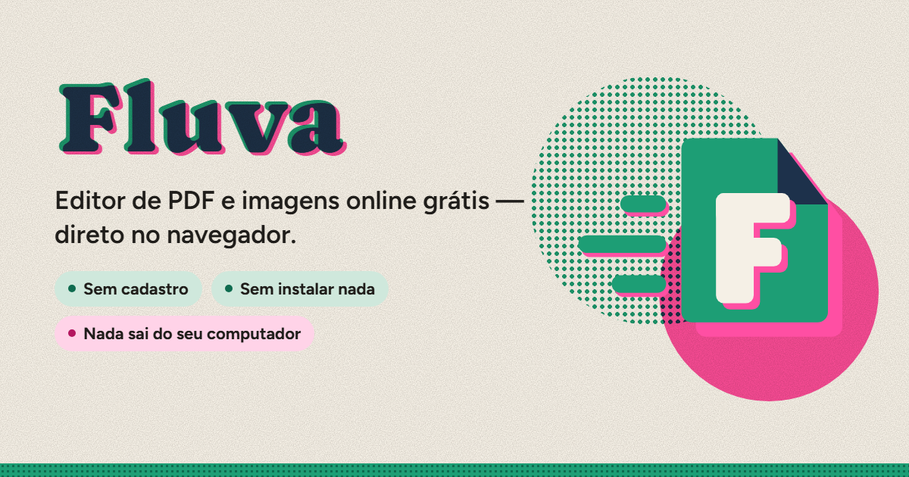

<p align="center">
  <a href="https://fluva.cyberhat.com.br"></a>
</p>

<p align="center">
  <a href="https://fluva.cyberhat.com.br"><b>fluva.cyberhat.com.br</b></a> · <a href="https://fluva.cyberhat.com.br/en/">English</a>
</p>

# Fluva

Editor de PDF e imagens grátis que roda inteiro no navegador. Sem cadastro, sem instalar nada e sem mandar seus arquivos para servidor nenhum: tudo é processado no seu aparelho. Também funciona como app instalável (PWA) e como app de desktop (Tauri).

## O que dá para fazer

- **Editar PDF**: substituir, mover e remover texto, adicionar texto, imagens e formas, e até copiar a fonte de um texto que já está na página
- **Juntar, dividir e reorganizar** páginas, com pré-visualização, além de girar, excluir e adicionar páginas em branco
- **Comprimir** arquivos sem perder o texto (as imagens são recomprimidas e reduzidas ao tamanho em que aparecem) e aplicar **marca d'água**
- **Abrir PDFs protegidos por senha**, pedindo a senha na hora
- **Converter** entre PDF, PNG, JPG e WebP, e exportar como documento do Word (`.docx`) com o texto e as imagens do PDF
- **Assinar digitalmente** com certificado ICP-Brasil (PAdES), com carimbo visível na página e sem invalidar as assinaturas que o PDF já tem
- **Editar imagens**: cortar com proporções, girar, espelhar, endireitar, aplicar filtros e inverter as cores
- Desfazer e refazer (<kbd>Ctrl</kbd>+<kbd>Z</kbd> / <kbd>Ctrl</kbd>+<kbd>Y</kbd>), zoom que segue o cursor e interface em português e inglês

## Como funciona

| Parte | Tecnologia |
|---|---|
| Interface | React 18 + TypeScript + Vite |
| Leitura e renderização | [pdf.js](https://mozilla.github.io/pdf.js/) |
| Edição e montagem do PDF | [pdf-lib](https://pdf-lib.js.org/) + fontkit |
| Assinatura ICP-Brasil | [node-forge](https://github.com/digitalbazaar/forge) |
| Exportação para Word | [docx](https://docx.js.org/) |
| Uso offline | vite-plugin-pwa |
| App de desktop | [Tauri 2](https://tauri.app/) (Rust) |

O código fica em `src/`: as telas em `screens/`, tudo o que mexe no PDF em `pdf/` (carregar, extrair e substituir texto, editar imagens, assinar, exportar), os componentes em `components/` e os textos em português e inglês em `i18n/`.

## Rodando localmente

```bash
npm install
npm run dev          # http://localhost:5173
npm run build        # gera dist/
npm run preview      # serve o dist/
npm run tauri:dev    # app de desktop (precisa do Rust)
npm run tauri:build  # instalador do app de desktop
npm run test:e2e     # testes de ponta a ponta no site já construído (rode o build antes)
```

Os testes de ponta a ponta ficam em `tests/e2e/` e rodam num Chrome ou Edge headless com os mesmos cabeçalhos de segurança do site em produção. `npm run test:e2e -- --app` roda os mesmos testes no app de desktop (gere antes com `npx tauri build --debug --no-bundle`), e `npm run test:e2e -- --list` mostra as partes que dá para rodar separadas.

---

Feito por [Vinícius Costa Magalhães](https://portfolio.cyberhat.com.br) · [Cyberhat](https://cyberhat.com.br)
